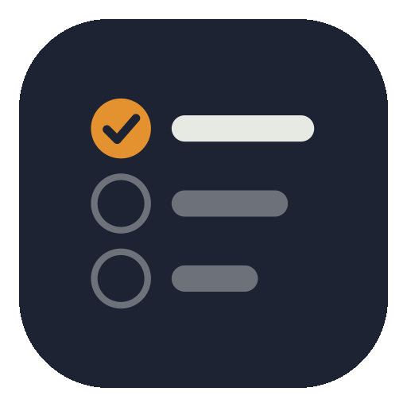
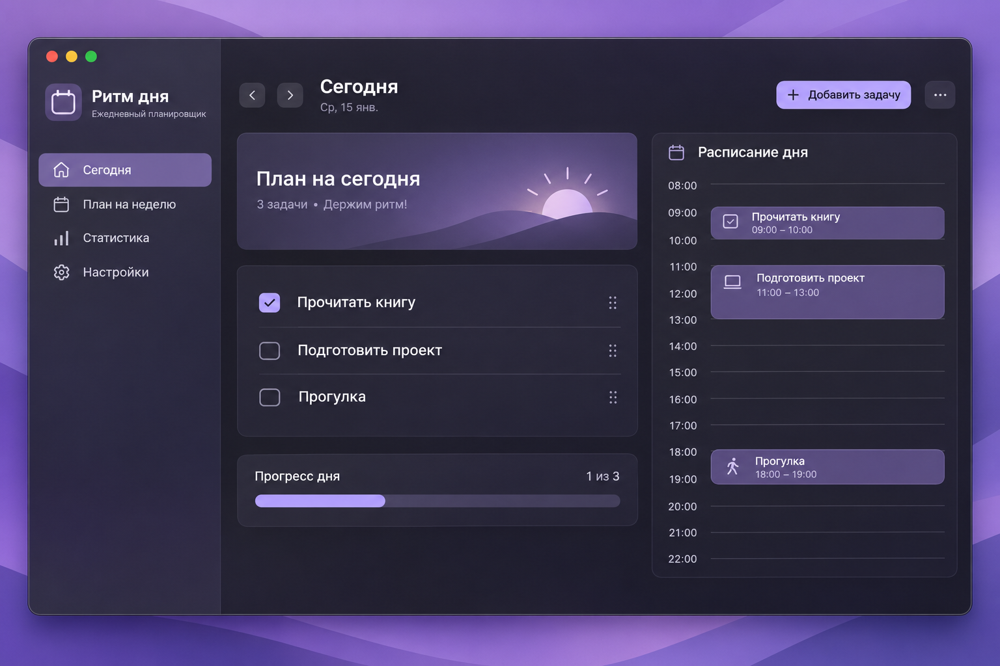

<div align="center">
  
  <h1>Ритм дня</h1>
  <p><strong>Задачи, занятия и привычки в одном планере для macOS.</strong></p>
  <p>Планируйте день по часам, смотрите всю неделю и находите время для важного.</p>
  <p>  </p>
</div>



*Демонстрационный макет, созданный для README. Задачи вымышлены; внешний вид может отличаться от текущей версии приложения.*

## ✨ Возможности

- **План на день и неделю:** добавляйте задачи, задавайте время и длительность, отмечайте выполненное.
- **Теги и значки:** создавайте цветные категории и фильтруйте задачи по ним.
- **Расписание занятий:** добавляйте пары и смотрите их вместе с повседневными делами.
- **Близкие люди:** ведите отдельные расписания и накладывайте их друг на друга.
- **Привычки и статистика:** отмечайте привычки и следите за прогрессом.
- **Оформление:** выбирайте светлую, тёмную или кастомную тему, цвета и другие настройки интерфейса.
- **Экспорт:** сохраняйте план на день или неделю в HTML или SVG.

## 🚀 Запуск на Mac

Потребуются **macOS 14 или новее** и **Xcode со Swift 6**. Убедитесь, что выбран путь к инструментам Xcode, затем выполните в терминале:

```bash
git clone https://github.com/freedrobili/ritm-dnya.git
cd ritm-dnya
./build-mac-app.sh
open build/Планер.app
```

Скрипт собирает приложение в `build/Планер.app`. Его можно перенести в папку «Программы». Если Xcode установлен в другом месте, укажите путь через переменную `DEVELOPER_DIR`.

## 🗂 Данные и перенос

Приложение работает локально и использует SwiftData для хранения данных. В боковом меню есть пункт **«Перенести данные»** для импорта базы прежнего Laravel-планера. Сохраняйте резервную копию исходной базы перед переносом.

## 🛠 Технологии

Swift 6 · SwiftUI · SwiftData · Swift Package Manager · SQLite для импорта прежних данных
